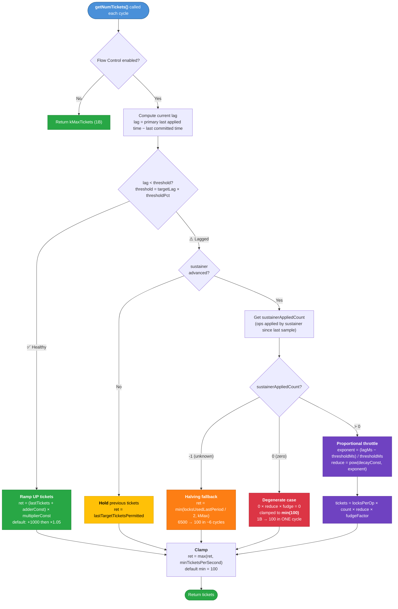

# Flow Control

## Overview

**Flow Control** is a replication-aware admission control mechanism that throttles write throughput
on the primary when secondaries are lagging. It uses a "ticket admission"-based approach: operations
must acquire a flow control ticket before acquiring the global IX lock to execute a write. This
ensures the primary doesn't get too far ahead of the majority commit point, maintaining replica set
consistency and preventing unbounded oplog growth.

Flow Control requires majority read concern to be enabled. In Primary-Secondary-Arbiter (PSA)
replica sets where a majority cannot be established, Flow Control is disabled to avoid possible
indefinite stalls.

## Purpose

Flow control:

- Monitors replication lag (commit point vs primary's last applied)
- Dynamically adjusts ticket allocation based on secondary progress
- Prevents primary from outrunning slow secondaries
- Only active on primaries with majority read concern enabled

## Key Files

- `flow_control.h` / `flow_control.cpp` - Main implementation
- `flow_control_parameters.idl` - Configuration parameters

## Architecture

### Core Concepts

1. **Sustainer Timestamp**

   - The median applied timestamp across all secondaries (`sortedMemberData[size/2]`)
   - The sustainer is the secondary at this median position. If it catches up, the median advances
     forward until another secondary becomes the new sustainer
   - Flow Control throttles the primary to the pace of this median secondary, not the slowest one

2. **Target Timestamp**

   - Last committed (majority) timestamp
   - This is what the primary tries to throttle to

3. **Lag Calculation**

   - Difference between primary's last write time and target (committed) time
   - Measured in wall-clock time (milliseconds)
   - When lag exceeds threshold, flow control activates

4. **sustainerAppliedCount (sustainerRate)**

   `sustainerRate` in FTDC is "an approximation of the number of operations applied in the last
   second by the secondary that is sustaining the commit point." It is the **baseline input** to the
   throttle formula — Flow Control uses it to estimate how fast the sustainer CAN process ops, then
   scales it down by the exponential decay factor.

   **Standard replication example (3-node replica set):** Primary writes 8,000 ops/s. Secondary A
   applies 7,000 ops/s. Secondary B applies 5,000 ops/s. The member data is sorted by applied
   optime; the sustainer is at index `size/2 = 1` (Secondary B). Between two Flow Control cycles,
   Secondary B's oplog position advances from T1 to T2. Flow Control queries its sample table:
   "between T1 and T2 there were 5,000 ops." So `sustainerAppliedCount = 5,000`. At threshold
   crossing (i.e. lag equals the threshold, so `exponent = 0` and the decay factor
   `reduce = pow(decayConstant, 0) = 1.0`): `tickets = locksPerOp * 5,000 * 1.0 * 0.95`. The primary
   is throttled to the sustainer's capacity — proportional and correct.

### Algorithm

#### Visual Overview



> **Color key:** 🟢 Green = healthy/ramp-up · 🟡 Yellow = hold steady · 🟠 Orange = halving fallback
> · 🔴 Red = degenerate cliff drop · 🟣 Purple = proportional throttle (main decay formula)

#### Details

The flow control algorithm runs periodically (default every 1 second, configurable via
`flowControlPollIntervalMs`) and calculates:

1. **If Healthy (lag < threshold)**

   ```cpp
   ret = (lastTickets + adderConstant) * multiplierConstant
   ```

   - Aggressively increases tickets to maximize throughput
   - Uses additive + multiplicative ramp-up for fast recovery
   - Defaults: `adderConstant = 1000`, `multiplierConstant = 1.05`
   - From 100 → 1B takes ~30 cycles (~30 seconds)
   - When tickets reach kMaxTickets (1 billion), Flow Control is effectively disengaged — the ticket
     count is clamped and no throttling occurs. Flow Control re-engages when lag exceeds the
     threshold again.

2. **If Lagged and sustainer advanced (lag >= threshold)**

   ```cpp
   thresholdLagMillis = targetLagSeconds * thresholdPercentage * 1000
   exponent = (currentLagMillis - thresholdLagMillis) / thresholdLagMillis
   reduce = pow(decayConstant, exponent)
   tickets = locksPerOp * sustainerAppliedCount * reduce * fudgeFactor
   ```

   The formula is designed for **proportional throttling**: at threshold crossing (`exponent = 0`,
   `reduce = 1.0`), tickets match the sustainer's rate. As lag grows, `reduce` decays exponentially.

   With `targetLagSeconds = 3`, `thresholdPercentage = 0.5` → threshold = 1.5s:

   | Current Lag      | Exponent | reduce (0.5^exp) | Ticket fraction        |
   | ---------------- | -------- | ---------------- | ---------------------- |
   | 1.5s (threshold) | 0        | 1.0              | sustainer rate × 95%   |
   | 3.0s (target)    | 1.0      | 0.50             | sustainer rate × 47.5% |
   | 4.5s             | 2.0      | 0.25             | sustainer rate × 23.8% |
   | 6.0s             | 3.0      | 0.125            | sustainer rate × 11.9% |

   **`targetLagSeconds` is NOT a hard cap.** It is a reference point for the decay curve (where
   `reduce = decayConstant`). Lag can exceed it. The algorithm applies progressively stronger
   throttling but does not guarantee lag stays below the target.

   **`thresholdPercentage` controls the engagement point:** `threshold = target × percentage`. At
   this lag level Flow Control transitions from healthy (ramp-up) to lagged (throttle). These two
   parameters are always used combined for the threshold, but `targetLagSeconds` alone also sets the
   exponent's denominator (the decay curve shape).

3. **If Lagged but sustainerAppliedCount = -1 (unknown)**

   ```cpp
   return min(locksUsedLastPeriod / 2.0, kMaxTickets);
   ```

   Halving fallback — when Flow Control has no data about the sustainer. Halves available throughput
   each cycle. From 6,500 → 100 in ~6 cycles (6 seconds).

4. **If Lagged but sustainerAppliedCount = 0**

   ```cpp
   tickets = locksPerOp * (0 * reduce * fudge) = 0 → clamped to min(100)
   ```

   **This is the degenerate case:** `0 × anything = 0`, bypassing the proportional formula. Drops
   from 1B to 100 in **one cycle**. This can happen when the sustainer's oplog timestamp advanced
   but its progress falls between sample boundaries (so `_approximateOpsBetween()` returns 0), or
   during extremely low-throughput periods.

   Note: this is different from case 5 below. Here, `sustainerAdvanced()` is `true` (topology is
   stable, sustainer timestamp did not go backwards), but no ops were found between the sample
   timestamps.

5. **If sustainer has NOT advanced (and not healthy)**

   ```cpp
   ret = _lastTargetTicketsPermitted;  // hold previous value
   ```

   This triggers when `sustainerAdvanced()` returns `false` — meaning the topology changed (member
   count differs between cycles) or the sustainer timestamp went backwards. Unlike case 4 which
   cliff-drops to min, this path **holds** the previous ticket count as a conservative fallback.

### Sampling System

Flow control maintains a sliding window of samples:

- Each sample: `(timestamp, opsApplied, lockAcquisitions)`
- Sampled every ~1000 operations
- Used to estimate operations between two timestamps
- Used to calculate `locksPerOp` ratio

## Key Methods

### `getNumTickets(Date_t now)`

Main entry point that calculates ticket allocation:

1. Checks if flow control is disabled (via `disableUntil`)
2. Updates topology information
3. Calculates lag
4. Determines if system is healthy or lagged
5. Calculates new ticket count using appropriate algorithm
6. Applies minimum ticket floor
7. Returns ticket count

### `sample(Timestamp timestamp, std::uint64_t opsApplied)`

Called by replication when new optimes are generated:

- Records timestamp, operation count, and lock acquisitions
- Maintains bounded sample history (max samples configurable)
- Used for estimating operations between timestamps

## Integration Points

### Used By

- **FlowControlTicketholder** - Receives ticket count and refreshes available tickets
- Replication system - Calls `sample()` when generating optimes

### Uses

- `ReplicationCoordinator` - Via `ReplicationTimestampProvider` for topology data
- `TicketHolder` - Indirectly through `FlowControlTicketholder`

## serverStatus / FTDC Metrics

The following metrics are reported under `db.serverStatus().flowControl` and captured in FTDC:

- `enabled` - Whether flow control is enabled
- `targetRateLimit` - Current ticket allocation
- `locksPerKiloOp` - Average lock acquisitions per operation, multiplied by 1000 for integer
  precision in FTDC
- `sustainerRate` - Operations applied by sustainer per period
- `isLagged` - Whether currently in lagged state
- `isLaggedCount` - Number of times entered lagged state
- `isLaggedTimeMicros` - Total time spent in lagged state
- `timeAcquiringMicros` - Time spent waiting for flow control tickets

## Configuration

### Server Parameters

All are runtime-tunable (`set_at: [startup, runtime]`).

**Throttle curve parameters:**

| Parameter                           | Default | Description                                                                                                                        |
| ----------------------------------- | ------- | ---------------------------------------------------------------------------------------------------------------------------------- |
| `enableFlowControl`                 | true    | Master on/off switch                                                                                                               |
| `flowControlTargetLagSeconds`       | 10      | Decay curve reference point. Where `reduce = decayConstant`. Also the exponent denominator (`thresholdMillis`). NOT a hard lag cap |
| `flowControlThresholdLagPercentage` | 0.5     | Fraction of target where Flow Control transitions from healthy to lagged. `engagement = target × percentage`                       |
| `flowControlDecayConstant`          | 0.5     | Base of exponential decay. Lower = more aggressive throttling at moderate lag. Valid range: (0, 1)                                 |
| `flowControlFudgeFactor`            | 0.95    | Penalty multiplier at threshold. 1.0 = no penalty. Reduces oscillations                                                            |

**Floor and ramp-up:**

| Parameter                             | Default | Description                                                        |
| ------------------------------------- | ------- | ------------------------------------------------------------------ |
| `flowControlMinTicketsPerSecond`      | 100     | Absolute floor — Flow Control never issues fewer tickets than this |
| `flowControlTicketAdderConstant`      | 1000    | Added to tickets each healthy cycle for recovery                   |
| `flowControlTicketMultiplierConstant` | 1.05    | Multiplied each healthy cycle. Must be > 1.0                       |

**Polling:**

| Parameter                   | Default | Description                                                                                                                 |
| --------------------------- | ------- | --------------------------------------------------------------------------------------------------------------------------- |
| `flowControlPollIntervalMs` | 1000    | Interval in milliseconds between refresh cycles. Lower values provide faster response to lag changes but increase CPU usage |

**Sampling:**

| Parameter                 | Default   | Description                                                |
| ------------------------- | --------- | ---------------------------------------------------------- |
| `flowControlSamplePeriod` | 1000      | Sample every N-th operation for `_sampledOpsApplied` table |
| `flowControlMaxSamples`   | 1,000,000 | Max entries in sample table                                |

**Diagnostics:**

| Parameter                         | Default | Description                                                    |
| --------------------------------- | ------- | -------------------------------------------------------------- |
| `flowControlWarnThresholdSeconds` | 10      | Log warning if sustainer hasn't advanced this long. 0 disables |

## Timing and Signal Delay

Flow Control runs every cycle (default 1 second, configurable via `flowControlPollIntervalMs`). The
lag signal it acts on is already stale:

1. **Heartbeat delay (standard repl):** Secondaries report applied optime via heartbeats (default 2s
   interval). Flow Control sees the secondary's position from 0–2 seconds ago.
2. **Flow Control cycle delay:** Lag may cross the threshold at any point in the polling window
   between checks. With the default 1s interval, worst case: detected 999ms late.
3. **Combined worst case at threshold 1.5s:** Real lag may be 2.5s–4.5s by the time Flow Control
   first throttles. After throttling begins, the halving path takes ~6 more seconds to reach the 100
   floor, during which more backlog accumulates.

This means `flowControlTargetLagSeconds` should be set with the understanding that actual peak lag
will overshoot by at least 1–3 seconds from signal delay alone.

## Initialization

1. Created when replication coordinator is initialized
2. Runs periodic job to refresh tickets (default every 1 second, configurable via
   `flowControlPollIntervalMs`)
3. Initialized with maximum tickets to avoid slow start
4. Registered as ServiceContext decoration

## Fail-Safe Mechanisms

1. **Sustainer Not Advancing**

   - Warns if sustainer hasn't moved in configured threshold
   - Indicates unhealthy secondaries

2. **Topology Changes**

   - Detects member count changes
   - Detects sustainer timestamp going backwards
   - Falls back to previous ticket count in unexpected cases

3. **Disable Until Deadline**
   - Can be temporarily disabled via `disableUntil()`
   - Useful for maintenance or recovery scenarios

## Dependencies

- `ReplicationCoordinator` - For topology and timestamp data
- `FlowControlTicketholder` - Receives ticket allocations
- Lock manager statistics - For `locksPerOp` calculation

## Relationship to Execution Control

Flow Control is one of two ticketing mechanisms placed in front of global lock acquisition:

1. **Flow Control** - Required only for global IX lock requests (MODE_IX, i.e., write operations)
2. **Execution Control** - Required for all global lock requests

When both ticket mechanisms are necessary, the acquisition order is:

1. Flow Control ticket (if MODE_IX)
2. Execution Control ticket

Operations of 'immediate' priority bypass Flow Control ticket acquisition regardless of ticket
availability. All other operations must wait when no tickets are available.

## Throttling Internal Operations

Flow Control throttles all global IX lock acquisitions regardless of whether they are from client or
system operations, unless they are part of an operation that is explicitly excluded. Writes that
occur as part of replica set elections in particular are excluded (see
[SERVER-39868](https://jira.mongodb.org/browse/SERVER-39868) for details).

## Oscillations

There are known scenarios in which Flow Control causes write throughput to oscillate. There is no
known work that can eliminate oscillations entirely without hindering other aspects of the
mechanism. Work was done (see [SERVER-39867](https://jira.mongodb.org/browse/SERVER-39867)) to
dampen the oscillations at the expense of throughput.
